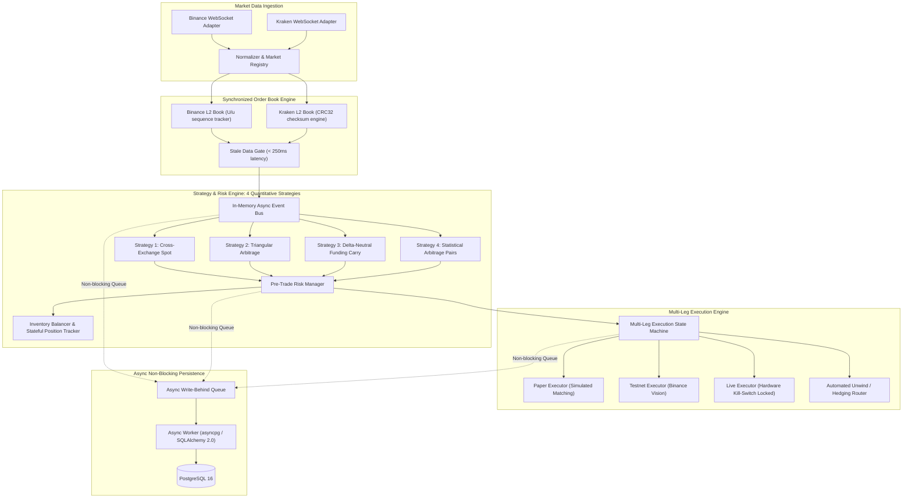

# System Architecture & Multi-Agent Engineering Blueprint

## 1. High-Level Modular Monolithic Architecture

The system is architected as an asynchronous, event-driven modular monolith. While maintaining a single deployment boundary, domain responsibilities are strictly separated across packages and protected by frozen interfaces.



---

## 2. Multi-Agent Governance & File Ownership Matrix

To prevent merge conflicts and maintain domain boundaries across parallel development, file ownership is strictly enforced:

| Agent Role | Exclusive Write Ownership | Read-Only Access | Dedicated Branch Pattern |
| :--- | :--- | :--- | :--- |
| **Lead Agent** | `src/core/`, `src/main.py`, `src/api/`, `config/`, `docs/`, `pyproject.toml`, `migrations/` | Entire Repository | `phase0-arch-spec`, `phase0-v2-four-strategies`, `integration/phase-*` |
| **Agent 1 (Data)** | `src/exchanges/` (Spot & Perps), `src/market_data/` (incl. `timeseries.py`), `tests/unit/test_market_data*`, `tests/unit/test_exchanges*` | `src/core/`, `config/`, `docs/` | `agent1/phase1-connectivity`, `agent1/phase2-market-data` |
| **Agent 2 (Quant)** | `src/strategies/` (`cross_exchange.py`, `triangular.py`, `funding_basis.py`, `stat_arb.py`), `src/opportunity/`, `tests/unit/test_strategies*`, `tests/unit/test_opportunity*` | `src/core/`, `src/market_data/`, `docs/` | `agent2/phase3-strategies` |
| **Agent 3 (Risk/Exec)**| `src/risk/`, `src/execution/`, `src/portfolio/` (incl. `positions.py`), `src/persistence/`, `tests/unit/test_risk*`, `tests/unit/test_execution*`, `tests/unit/test_persistence*` | `src/core/`, `config/`, `docs/` | `agent3/phase4-risk`, `agent3/phase5-paper`, `agent3/phase6-execution`, `agent3/phase7-persistence` |
| **Agent 4 (QA/Val)** | `tests/integration/`, `tests/simulation/`, `src/analytics/`, `dashboard/` | Entire Repository | `agent4/phase8-analytics`, `agent4/phase9-dashboard` |

### Critical Governance Rule
Specialist Agents are strictly forbidden from modifying `src/core/models.py`, `src/core/interfaces.py`, `src/core/events.py`, or `src/core/exceptions.py`. Any required schema or interface modifications must be requested through the Lead Agent.

---

## 3. Multi-Leg Execution & Legging Risk State Machine

### 3.1 State Transitions

```
[IDLE]
  │
  ├── 1. Pre-Trade Risk Approved
  ▼
[SUBMITTING_LEGS]
  │
  ├── Strategy A: Concurrent IOC Submission to Exchange 1 & Exchange 2
  ├── Strategy B: Chained Sequential Submission (Leg 1 -> Leg 2 -> Leg 3)
  ▼
[EVALUATING_FILLS]
  ├── Case 1: All legs filled -> [COMPLETED]
  ├── Case 2: Zero legs filled (IOC cancelled) -> [REJECTED_NO_EXPOSURE]
  ├── Case 3: Leg 1 filled, Leg 2 partial/rejected -> [LEGGING_RISK_DETECTED]
  │                                                        │
  │                                                        ▼
  │                                               [EMERGENCY_UNWIND]
  │                                                        │
  │                                            Market Hedge on Leg 1
  │                                                        │
  │                                            ┌───────────┴───────────┐
  │                                            ▼                       ▼
  │                                       [UNWOUND]          [EMERGENCY_HALT]
  │                                   (PnL Recorded)      (Circuit Breaker Tripped)
```

### 3.2 Unwind Policy
- If Leg 1 fills and Leg 2 is rejected:
  1. The execution state machine immediately dispatches an IOC/market order on Leg 1's exchange in the reverse direction.
  2. Maximum slippage allowed for unwinding: 50 basis points.
  3. If the position is not flattened within 500ms, the system engages the global kill-switch (`SYSTEM_HALT`), preventing any further trade submissions.

---

## 4. Non-Blocking Persistence Architecture

1. **In-Memory Write Queue:**
   - Real-time trading components place records into an `asyncio.Queue(maxsize=10000)`.
   - The method `put_nowait()` is used. If the queue is saturated, snapshots are discarded while execution records are prioritized.
2. **Background Persistence Worker:**
   - A dedicated `asyncio.Task` continuously drains the queue in batches (e.g. 100 items or every 50ms).
   - Uses `asyncpg` parameterized bulk inserts: `INSERT INTO ... VALUES (...)`.
3. **Partitioning & Pruning:**
   - Raw L2 snapshots are stored in weekly partitions and dropped automatically after 7 days.
   - Arbitrage opportunity and execution records are retained permanently.
