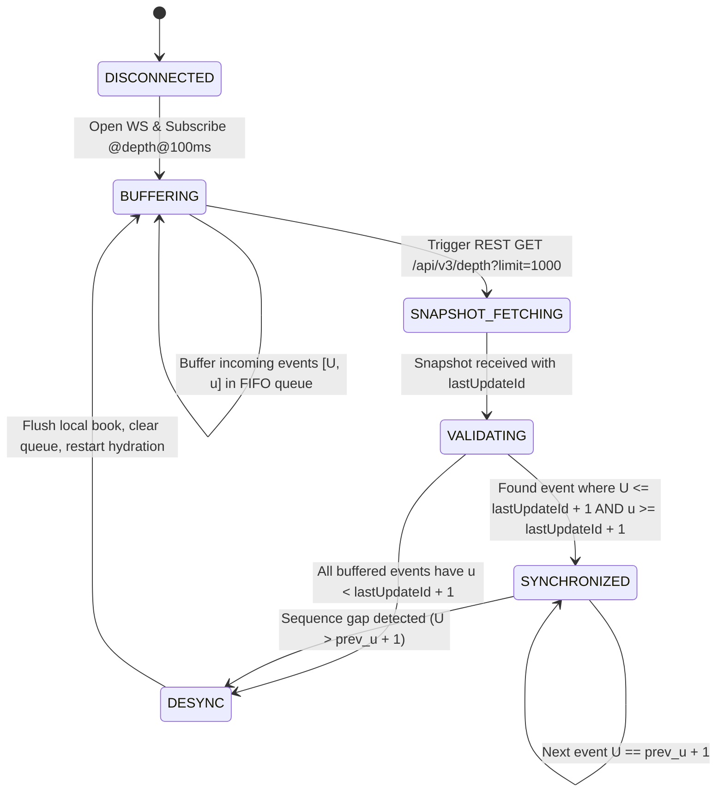
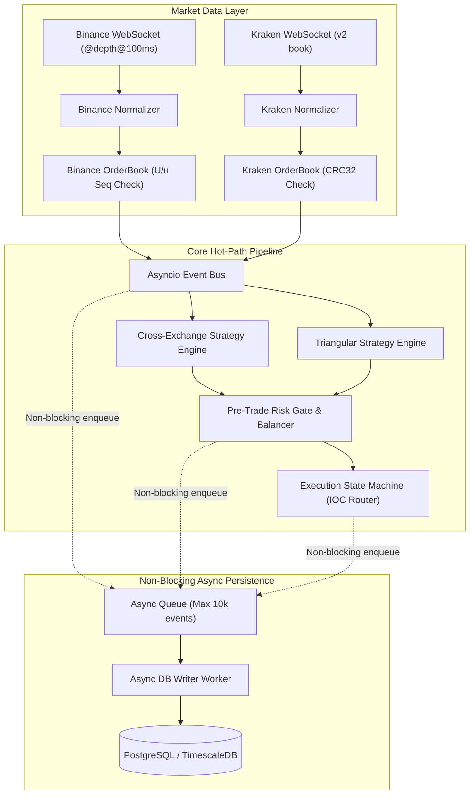
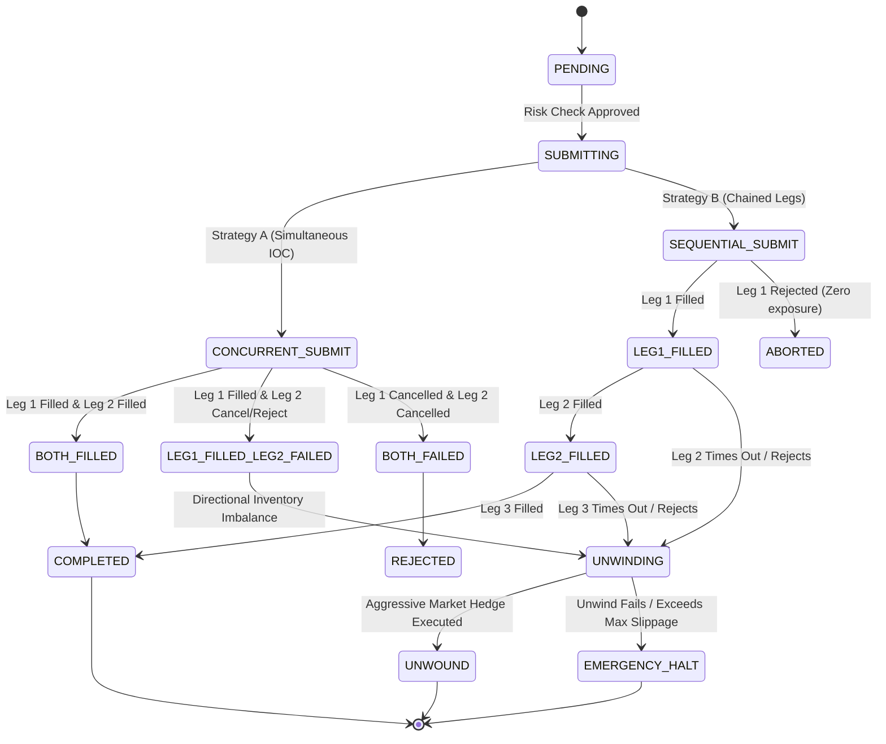

# Phase 0: Technical Specification & Architecture Blueprint

**Project:** Crypto Arbitrage Intelligence & Trading System  
**Lead Architect:** Lead Quantitative Systems Architect & Python Backend Engineer  
**Status:** COMPLETE (Pending Project Owner Sign-Off)  
**Branch:** `phase0-arch-spec`  
**Execution Target:** Binance Spot & Kraken Spot  

---

## 1. Workspace & Environment Audit

### 1.1 Host Environment & Hardware Baseline
- **Operating System:** Linux (Ubuntu 24.04 LTS / Debian-based, x86_64 architecture).
- **Python Runtime:** Python `3.14.4` (Standard CPython runtime).
- **Virtual Environment:** Configured at `.venv/` isolated from system packages.
- **Git Repository:**
  - Initialized with default branch `main`.
  - Feature branch `phase0-arch-spec` checked out.
  - Remote configured to `https://github.com/Melke41/crypto-arbitrage-system.git`.
  - Security `.gitignore` active (protecting `.env`, `.pem`, `secrets/`, logs, and parquet files).

### 1.2 Dependency & Toolchain Readiness
- **Core Runtime Dependencies:**
  - `pydantic>=2.6.0`: Strict schema validation with frozen models and `Decimal` serialization.
  - `websockets>=12.0` & `aiohttp>=3.9.0`: Non-blocking asynchronous networking for streaming feeds and REST requests.
  - `sqlalchemy[asyncio]>=2.0.25` & `asyncpg>=0.29.0`: Non-blocking async ORM and PostgreSQL driver.
  - `alembic>=1.13.0`: Schema migrations and versioning.
  - `numpy>=1.26.0` & `pandas>=2.2.0`: Reserved exclusively for offline analytics, post-trade reporting, and backtesting (strictly excluded from hot path).
  - `fastapi>=0.109.0` & `uvicorn>=0.27.0`: Local monitoring API and health endpoints.
  - `streamlit>=1.31.0`: Operations dashboard for visual monitoring.
- **Verification Toolchain:**
  - `pytest>=8.0.0` & `pytest-asyncio>=0.23.0`: Automated test execution.
  - Verification run: Core domain contracts passed 9/9 unit tests (`test_core_models.py`) with zero warnings.

---

## 2. Exchange Capability & Constraint Matrix (Binance Spot vs. Kraken Spot)

| Capability / Attribute | Binance Spot | Kraken Spot | Architectural Design Impact |
| :--- | :--- | :--- | :--- |
| **REST Base URL** | `https://api.binance.com/api/v3` | `https://api.kraken.com/0/` | Exchange adapters abstract endpoint differences behind unified protocol. |
| **Public WebSocket** | `wss://stream.binance.com:9443/ws` | `wss://ws.kraken.com/v2` | Kraken v2 delivers JSON schema with CRC32 checksums; Binance uses stream multiplexing. |
| **Private WebSocket** | `POST /api/v3/userDataStream` -> listenKey (`wss://stream.binance.com:9443/ws/<listenKey>`) | `wss://ws-auth.kraken.com/v2` via REST `GetWebSocketsToken` | Private order placement and balance update feeds use separate authenticated sockets. |
| **L2 Depth Channel** | `<symbol>@depth@100ms` (diff stream) | Channel `book` with `depth: 100` | Binance pushes diffs every 100ms; Kraken pushes snapshot then delta updates. |
| **L2 Integrity Mechanism** | Sequence continuity check (`lastUpdateId`, `U`, `u`) | **CRC32 Checksum Verification** on top 10 bids/asks | Automatic book rebuild triggered on any sequence gap or checksum drift. |
| **Rate Limit Model** | Request Weight: 1200 weight/min per IP; Orders: 100/10s, 200,000/24h | Call Counter: Max counter 15–20, decay 0.33–1.0 calls/sec | Token-bucket rate limiter implemented in memory before requests are dispatched. |
| **Standard Fees (Base)** | Maker: 0.10%, Taker: 0.10% (0.075% with BNB) | Maker: 0.16%–0.25%, Taker: 0.26%–0.40% | Net spread calculation must compound exchange-specific taker fees per leg. |
| **Order Types Supported** | `LIMIT`, `MARKET`, `LIMIT_MAKER`, `IOC` via Limit | `limit`, `market`, `iceberg`, `post-only`, `ioc` | Arbitrage execution strictly enforces `IOC` (Immediate-or-Cancel) limit orders. |
| **Precision & Filters** | `PRICE_FILTER` (`tickSize`), `LOT_SIZE` (`stepSize`, `minQty`), `NOTIONAL` (`minNotional`) | `tick_size`, `lot_decimals`, `ordermin`, `costmin` | Sizing engine floor-truncates order quantities to common lot precision. |
| **Symbol Naming** | Concatenated uppercase: `BTCUSDT`, `ETHUSDT` | v2 WebSocket: `BTC/USD`, `BTC/USDT`; REST: `XXBTZUSD` | System uses normalized `BASE/QUOTE` standard internally (e.g. `BTC/USDT`). |
| **Testnet Availability** | Full Spot Testnet (`testnet.binance.vision`) with real matching engine | **No Public Spot Testnet** (Kraken demo exists only for Futures) | Binance uses testnet for demo fills; Kraken utilizes live L2 data + internal simulated paper matcher. |

### 2.1 Binance Spot L2 Synchronization State Machine
Binance provides continuous differential depth events over `@depth@100ms`. To guarantee state consistency without missed packets:


### 2.2 Kraken Spot v2 L2 CRC32 Checksum State Machine
Kraken v2 `book` channel pushes an initial `snapshot`, followed by incremental updates containing a 32-bit CRC32 checksum over the top 10 bids and top 10 asks:
1. **Initial Hydration:** Ingest `snapshot` payload, populate top 100 bids and asks sorted descending and ascending respectively.
2. **Incremental Update:** Process `update` payload:
   - For each price level: if updated quantity is `0.0`, delete level; otherwise update or insert level.
3. **CRC32 Checksum Calculation:**
   - Iterate top 10 asks from lowest price to highest: format string as `"{price_str}{qty_str}"` (stripping decimal separators and leading zeroes per Kraken v2 specification).
   - Iterate top 10 bids from highest price to lowest: format string as `"{price_str}{qty_str}"`.
   - Concatenate all 20 strings into a single ASCII string.
   - Compute standard IEEE 802.3 `crc32(concatenated_bytes) & 0xFFFFFFFF`.
   - Compare computed value with `checksum` field in WebSocket message.
4. **Drift Handling:** If computed CRC32 != received checksum, immediately mark book `STALE`, log error, drop book state, and request fresh snapshot subscription.

### 2.3 Stale Data Gate
To prevent trading on delayed network packets, every order book maintains:
$$\Delta t_{latency} = t_{local\_receipt\_ms} - t_{exchange\_matching\_ms}$$
$$\Delta t_{staleness} = t_{now\_ms} - t_{local\_receipt\_ms}$$
- If $\Delta t_{staleness} > 250\text{ ms}$ or sequence integrity is compromised, the order book state is instantly flagged `is_stale = True`.
- Strategy engines reject any opportunity where any participating order book is flagged `is_stale`.

---

## 3. Candidate Trading Universe & Quote-Currency Strategy

### 3.1 Initial High-Liquidity Trading Universe
To maximize fill certainty and minimize slippage:
- **Primary Cross-Exchange Pairs (Binance vs. Kraken):**
  1. `BTC/USDT`
  2. `ETH/USDT`
  3. `SOL/USDT`
  4. `XRP/USDT`
- **Primary Triangular Cycles (Binance Spot):**
  - Cycle 1: `USDT -> BTC -> ETH -> USDT`
  - Cycle 2: `USDT -> ETH -> BTC -> USDT`
  - Cycle 3: `USDT -> SOL -> BTC -> USDT`
  - Cycle 4: `USDT -> BNB -> BTC -> USDT`
- **Primary Triangular Cycles (Kraken Spot):**
  - Cycle 1: `USDT -> BTC -> ETH -> USDT`
  - Cycle 2: `USD -> BTC -> ETH -> USD`
  - Cycle 3: `USD -> SOL -> BTC -> USD`

### 3.2 Quote-Currency Basis Strategy (USDT vs. USD)
Binance is strictly a stablecoin/crypto venue (denominated in `USDT`, `FDUSD`), whereas Kraken has immense fiat liquidity in `USD` and `EUR` alongside `USDT`:
- **Direct Parity Strategy (Selected Baseline):**
  - Restrict Strategy A to pairs where both venues quote in `USDT` (e.g. Binance `BTCUSDT` vs. Kraken `BTC/USDT`).
  - Completely eliminates FX basis risk and quote currency conversion decay.
- **Synthetic FX Basis Strategy (Secondary Feature):**
  - If evaluating Binance `BTC/USDT` against Kraken `BTC/USD`:
    $$P_{synthetic\_USDT} = \frac{P_{Kraken\_USD}}{R_{Kraken\_USDT/USD}}$$
  - Introduces triangular legging exposure since settling the arbitrage requires inventory rebalancing across USD and USDT.
  - **Phase 0 Rule:** Strategy A operates strictly in direct `USDT` pairs during initial phases. Synthetic FX evaluation is gated behind explicit flag `ENABLE_SYNTHETIC_FX_BASIS=False`.

---

## 4. Core Domain Models & Exact Math Specification

### 4.1 Opportunity Lifecycle States
All database records, memory caches, and telemetry events explicitly categorize opportunities into 5 lifecycle stages:
```
1. THEORETICAL_OPPORTUNITY
   └─ Detected when top-of-book gross spread > 0.

2. EXECUTABLE_OPPORTUNITY
   └─ Order book depth walk (VWAP) net of exchange maker/taker fees, 
      lot_size/tick_size rounding, and min_notional > min_net_edge_bps.

3. SIMULATED_FILL
   └─ Paper execution accounting for simulated latency decay (e.g. 50ms), 
      queue walk, and partial fill modeling.

4. DEMO_TESTNET_FILL
   └─ Submitted and confirmed on Binance Spot Testnet (testnet.binance.vision).

5. LIVE_FILL
   └─ Submitted to live production matching engines (Requires cryptographic kill-switch override).
```

### 4.2 Exact Mathematical Formulations

#### Strategy A: Cross-Exchange Spot Arbitrage (Pre-Funded Inventory Model)
Assume Exchange 1 (Buy Venue, lower ask) and Exchange 2 (Sell Venue, higher bid).
- Let $L_{ask1} = \{(P_{a1, i}, Q_{a1, i})\}_{i=1}^{m}$ be the ask levels of Exchange 1.
- Let $L_{bid2} = \{(P_{b2, j}, Q_{b2, j})\}_{j=1}^{n}$ be the bid levels of Exchange 2.

**Step 1: Theoretical Top-of-Book Spread**
$$S_{gross} = P_{b2, 1} - P_{a1, 1}$$
$$\text{Edge}_{gross\_bps} = \frac{S_{gross}}{P_{a1, 1}} \times 10,000$$
If $\text{Edge}_{gross\_bps} \le 0$, terminate evaluation.

**Step 2: Depth Walk & VWAP Computation**
For a target base quantity $Q$:
1. Sizing truncation:
   $$Q_{exec} = \text{floor}\left(Q, \max(\text{lot\_size}_1, \text{lot\_size}_2)\right)$$
2. Exchange 1 Ask VWAP (Cost to buy $Q_{exec}$):
   $$C_{gross} = \sum_{i=1}^{k} P_{a1, i} \cdot q_{a1, i} \quad \text{where} \quad \sum_{i=1}^{k} q_{a1, i} = Q_{exec}$$
   $$P_{vwap\_buy} = \frac{C_{gross}}{Q_{exec}}$$
3. Exchange 2 Bid VWAP (Gross proceeds from selling $Q_{exec}$):
   $$R_{gross} = \sum_{j=1}^{l} P_{b2, j} \cdot q_{b2, j} \quad \text{where} \quad \sum_{j=1}^{l} q_{b2, j} = Q_{exec}$$
   $$P_{vwap\_sell} = \frac{R_{gross}}{Q_{exec}}$$

**Step 3: Fee Deductions & Net Profit**
- Exchange 1 taker fee (in quote asset): $\text{Fee}_1 = C_{gross} \cdot f_{taker, 1}$
- Exchange 2 taker fee (in quote asset): $\text{Fee}_2 = R_{gross} \cdot f_{taker, 2}$
- Net Profit:
  $$\Pi_{net} = R_{gross} - C_{gross} - \text{Fee}_1 - \text{Fee}_2$$
- Net Edge in Basis Points:
  $$\text{Edge}_{net\_bps} = \frac{\Pi_{net}}{C_{gross}} \times 10,000$$

**Step 4: Executability Invariants**
An opportunity transitions to `EXECUTABLE_OPPORTUNITY` iff:
1. $\text{Edge}_{net\_bps} \ge \text{min\_net\_edge\_bps}$ (e.g. 15.0 bps).
2. $C_{gross} \ge \max(\text{minNotional}_1, \text{minNotional}_2)$.
3. Pre-funded Balance on Ex 1: $\text{Balance}_{free}(\text{Quote}_1) \ge C_{gross} \cdot (1 + f_{taker, 1})$.
4. Pre-funded Balance on Ex 2: $\text{Balance}_{free}(\text{Base}_2) \ge Q_{exec}$.

---

#### Strategy B: Single-Exchange Triangular Arbitrage
Consider a 3-leg cycle $A \to B \to C \to A$ on exchange $E$ with initial capital $K_0$ in starting asset $A$ (e.g. USDT):

**Leg 1: Asset $A \to$ Asset $B$ (Symbol $S_1$)**
- If Leg 1 is BUY (Base $B$, Quote $A$):
  $$Q_{raw, 1} = \frac{K_0}{P_{ask, 1}}$$
  $$Q_{exec, 1} = \text{floor}(Q_{raw, 1}, \text{lot\_size}_1)$$
  $$K_{spent, 1} = Q_{exec, 1} \cdot P_{vwap\_ask, 1}$$
  $$\text{Fee}_1 = Q_{exec, 1} \cdot f_{taker}$$
  $$K_1 = Q_{exec, 1} - \text{Fee}_1 \quad (\text{denominated in Asset } B)$$
- If Leg 1 is SELL (Base $A$, Quote $B$):
  $$Q_{exec, 1} = \text{floor}(K_0, \text{lot\_size}_1)$$
  $$K_{gross, 1} = Q_{exec, 1} \cdot P_{vwap\_bid, 1}$$
  $$\text{Fee}_1 = K_{gross, 1} \cdot f_{taker}$$
  $$K_1 = K_{gross, 1} - \text{Fee}_1 \quad (\text{denominated in Asset } B)$$

**Leg 2: Asset $B \to$ Asset $C$ (Symbol $S_2$)**
- Repeat identical depth-walking, lot size floor truncation, and fee deduction using $K_1$ as input to obtain $K_2$ in Asset $C$.

**Leg 3: Asset $C \to$ Asset $A$ (Symbol $S_3$)**
- Repeat identical depth-walking, lot size floor truncation, and fee deduction using $K_2$ as input to obtain final returned capital $K_{final}$ in starting asset $A$.

**Triangular Net Profit & Edge**
$$\Pi_{tri\_net} = K_{final} - K_0$$
$$\text{Edge}_{tri\_bps} = \frac{K_{final} - K_0}{K_0} \times 10,000$$

Condition: $\text{Edge}_{tri\_bps} \ge \text{min\_tri\_edge\_bps}$ (e.g. 10.0 bps) AND every intermediate leg satisfies $K_{spent, i} \ge \text{minNotional}_i$.

---

## 5. Interfaces & Event Flow Architecture

### 5.1 Pipeline Topology
The system uses a completely non-blocking, event-driven `asyncio` architecture. Computationally heavy or blocking calls (database queries, network I/O) are decoupled from the real-time event pipeline via bounded async queues:



### 5.2 Latency Budgets & Execution Invariants
- **Hot-Path Processing Latency Budget:** $< 2.0\text{ ms}$ from WebSocket frame arrival to execution dispatch.
- **No Floating Point:** Zero `float` usage in sizing, pricing, fee deduction, or account balances.
- **No Pandas on Hot Path:** Pandas dataframes are strictly banned from market data normalization, opportunity evaluation, and execution loops.

---

## 6. Multi-Leg Execution & Legging Risk State Machine

### 6.1 State Transition Matrix



### 6.2 Failure & Unwind Policy
1. **Leg 1 Partial Fill / Timeout:**
   - Immediately cancel remaining unexecuted quantity of Leg 1.
   - For Strategy A: Size Leg 2 order to match the *exact* filled quantity of Leg 1 ($Q_{filled, 1}$).
   - For Strategy B: Size Leg 2 order using the exact net output received from Leg 1.
2. **Subsequent Leg Rejection / Slip Breached:**
   - If Leg 1 fills, but Leg 2 rejects or times out, the system enters `UNWINDING`.
   - **Immediate Hedge Order:** Submit an immediate market order on the exchange of Leg 1 to reverse the position (e.g. if Leg 1 bought 0.1 BTC on Binance, submit a market SELL for 0.1 BTC on Binance).
   - If the market order does not fill within 500ms or slippage exceeds `max_unwind_slippage_bps` (e.g. 50 bps), trigger `EMERGENCY_HALT`, alert via pager/logs, and stop automated execution across all strategies.

---

## 7. Database Schema Design & High-Frequency Retention

### 7.1 PostgreSQL (SQLAlchemy 2.0 Async + asyncpg) Schema

```sql
-- Opportunities Table: Records theoretical vs executable arbitrage detections
CREATE TABLE arbitrage_opportunities (
    id VARCHAR(64) PRIMARY KEY,
    strategy_type VARCHAR(32) NOT NULL,
    lifecycle_state VARCHAR(32) NOT NULL,
    symbol_legs JSONB NOT NULL,
    gross_edge_bps NUMERIC(10, 4) NOT NULL,
    net_edge_bps NUMERIC(10, 4) NOT NULL,
    target_notional NUMERIC(20, 8) NOT NULL,
    expected_net_profit NUMERIC(20, 8) NOT NULL,
    profit_asset VARCHAR(16) NOT NULL DEFAULT 'USDT',
    metadata JSONB,
    created_at TIMESTAMPTZ NOT NULL DEFAULT NOW()
);
CREATE INDEX idx_opp_created_state ON arbitrage_opportunities (created_at DESC, lifecycle_state);

-- Execution Plans: Multi-leg execution orchestration
CREATE TABLE execution_plans (
    id VARCHAR(64) PRIMARY KEY,
    opportunity_id VARCHAR(64) REFERENCES arbitrage_opportunities(id),
    strategy_type VARCHAR(32) NOT NULL,
    status VARCHAR(32) NOT NULL,
    target_notional NUMERIC(20, 8) NOT NULL,
    realized_pnl NUMERIC(20, 8) NOT NULL DEFAULT 0,
    pnl_asset VARCHAR(16) NOT NULL DEFAULT 'USDT',
    created_at TIMESTAMPTZ NOT NULL DEFAULT NOW(),
    updated_at TIMESTAMPTZ NOT NULL DEFAULT NOW()
);

-- Execution Legs: Individual exchange orders and fill records
CREATE TABLE execution_legs (
    id BIGSERIAL PRIMARY KEY,
    plan_id VARCHAR(64) REFERENCES execution_plans(id) ON DELETE CASCADE,
    leg_index INT NOT NULL,
    client_order_id VARCHAR(64) NOT NULL,
    exchange VARCHAR(32) NOT NULL,
    symbol VARCHAR(32) NOT NULL,
    side VARCHAR(16) NOT NULL,
    order_type VARCHAR(16) NOT NULL,
    time_in_force VARCHAR(16) NOT NULL,
    price NUMERIC(20, 8),
    quantity NUMERIC(20, 8) NOT NULL,
    filled_qty NUMERIC(20, 8) NOT NULL DEFAULT 0,
    average_fill_price NUMERIC(20, 8),
    fee_paid NUMERIC(20, 8) NOT NULL DEFAULT 0,
    fee_asset VARCHAR(16),
    status VARCHAR(32) NOT NULL,
    exchange_order_id VARCHAR(64),
    latency_ms INT,
    error_message TEXT,
    created_at TIMESTAMPTZ NOT NULL DEFAULT NOW()
);
CREATE INDEX idx_leg_plan_id ON execution_legs (plan_id);

-- L2 Order Book Auditing Snapshots (Partitioned by week)
CREATE TABLE order_book_snapshots (
    id BIGSERIAL,
    exchange VARCHAR(32) NOT NULL,
    symbol VARCHAR(32) NOT NULL,
    sequence_id BIGINT NOT NULL,
    exchange_timestamp_ms BIGINT NOT NULL,
    local_receipt_timestamp_ms BIGINT NOT NULL,
    best_bid NUMERIC(20, 8) NOT NULL,
    best_ask NUMERIC(20, 8) NOT NULL,
    mid_price NUMERIC(20, 8) NOT NULL,
    spread_bps NUMERIC(10, 4) NOT NULL,
    checksum_valid BOOLEAN NOT NULL DEFAULT TRUE,
    created_at TIMESTAMPTZ NOT NULL DEFAULT NOW(),
    PRIMARY KEY (id, created_at)
) PARTITION BY RANGE (created_at);

-- Account Balances
CREATE TABLE account_balances (
    id BIGSERIAL PRIMARY KEY,
    exchange VARCHAR(32) NOT NULL,
    asset VARCHAR(16) NOT NULL,
    free NUMERIC(20, 8) NOT NULL,
    locked NUMERIC(20, 8) NOT NULL,
    total NUMERIC(20, 8) NOT NULL,
    updated_at TIMESTAMPTZ NOT NULL DEFAULT NOW()
);
```

### 7.2 High-Frequency Storage Retention Policy
- `order_book_snapshots`: Pruned after 7 days; automated daily cron job drops weekly partitions older than 7 days.
- `arbitrage_opportunities`:
  - `THEORETICAL_OPPORTUNITY`: Retained for 14 days, then compressed to hourly statistical summaries.
  - `EXECUTABLE_OPPORTUNITY`, `SIMULATED_FILL`, `DEMO_TESTNET_FILL`, `LIVE_FILL`: Retained indefinitely.
- `execution_plans` and `execution_legs`: Retained indefinitely for tax, audit, and slippage analytics.

---

## 8. Phased Implementation Roadmap (Phases 1–9)

| Phase | Title | Assigned Agent | Deliverables & Acceptance Gates |
| :--- | :--- | :--- | :--- |
| **Phase 1** | **Exchange Connectivity & Normalization** | Agent 1 (Data) | Async WebSocket clients for Binance & Kraken; Symbol metadata registry; Mock & Live ping test passing. |
| **Phase 2** | **Verified L2 Order Book Engine** | Agent 1 (Data) | Binance diff-depth U/u tracking; Kraken CRC32 verification; Stale data gate ($<250$ms); Zero desync in 10-min playback test. |
| **Phase 3** | **Strategy Engines (Cross & Triangular)** | Agent 2 (Quant) | Directed 3-leg cycle pre-computation; Depth VWAP walker with per-hop fee and lot size truncation; Math unit tests passing. |
| **Phase 4** | **Pre-Trade Risk & Inventory Balancer** | Agent 3 (Risk/Exec) | Pre-funded inventory checks; Minimum edge gate; Max daily loss kill switch; 100% of breaching orders blocked. |
| **Phase 5** | **Paper & Testnet Execution Engine** | Agent 3 (Risk/Exec) | Simulated latency decay; Binance Spot Testnet router; Kraken paper-matcher; End-to-end simulated trade cycle verified. |
| **Phase 6** | **Multi-Leg State Machine & Unwind** | Agent 3 (Risk/Exec) | Concurrent IOC submission; Legging risk unwind engine; Partial-fill recovery tests passing. |
| **Phase 7** | **Non-Blocking Persistence Engine** | Agent 3 (Risk/Exec) | Async write-behind queue; Alembic migrations; Bulk insertion; 10,000 events/sec with zero loop delay. |
| **Phase 8** | **Quantitative Analytics & Performance** | Agent 4 (QA/Val) | Realized vs. theoretical spread slippage attribution; PnL tracking; Sharpe/Sortino metrics generator. |
| **Phase 9** | **Dashboard & Operational Hardening** | Agent 4 (QA/Val) | Real-time Streamlit/FastAPI monitoring UI; System-wide kill switch test; Continuous 2-hour stress test run. |

---

## 9. Open Architectural Decisions Requiring Project Owner Sign-Off

The following 6 architectural decisions require explicit sign-off from the Project Owner before Phase 1 coding begins:

1. **Quote-Currency Cross-Matching Mode:**
   - *Option A (Recommended):* Strict direct matching on `USDT` pairs on both exchanges (`BTC/USDT` on Binance vs. `BTC/USDT` on Kraken). Eliminates FX conversion risk.
   - *Option B:* Allow synthetic cross against Kraken `BTC/USD` using real-time `USDT/USD` conversion, accepting quote-currency basis risk.
2. **Kraken Testnet Alternative:**
   - *Option A (Recommended):* Use Binance Spot Testnet (`testnet.binance.vision`) for live network order execution testing, coupled with an internal simulated matching engine for Kraken Spot driven by Kraken live L2 book data.
   - *Option B:* Connect to third-party paper trading harness (e.g., CCXT sandbox).
3. **Emergency Unwind Aggressiveness:**
   - *Option A (Recommended):* IOC limit order at best market price $- 20\text{ bps}$ followed immediately by MARKET order if unfilled within 300ms.
   - *Option B:* Passive limit order re-quoting at mid price for up to 5 seconds before resorting to market unwind.
4. **Async Persistence Buffer Overflow Policy:**
   - *Option A (Recommended):* If async DB queue reaches capacity (e.g. 10,000 items), drop low-priority `order_book_snapshots` but strictly retain all `execution_plans` and `risk_events`.
   - *Option B:* Block event bus backpressure until DB queue drains (introduces latency spikes into market data loop).
5. **Initial Target Capital Allocation:**
   - Specify the default max notional per arbitrage trade (e.g., \$1,000 USDT or \$5,000 USDT) and the minimum executable net edge threshold (e.g., 15 basis points).
6. **Binance Fee Assumption:**
   - Assume standard VIP 0 tier with BNB fee deduction active (0.075% maker / 0.075% taker) or standard fee without BNB (0.10% maker / 0.10% taker).
